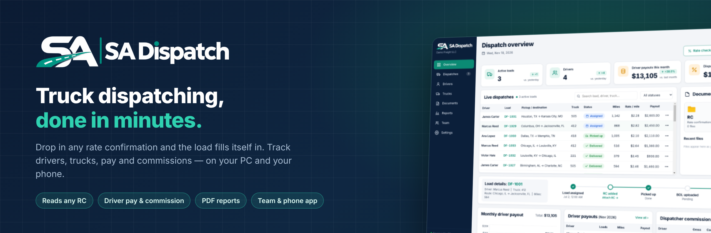
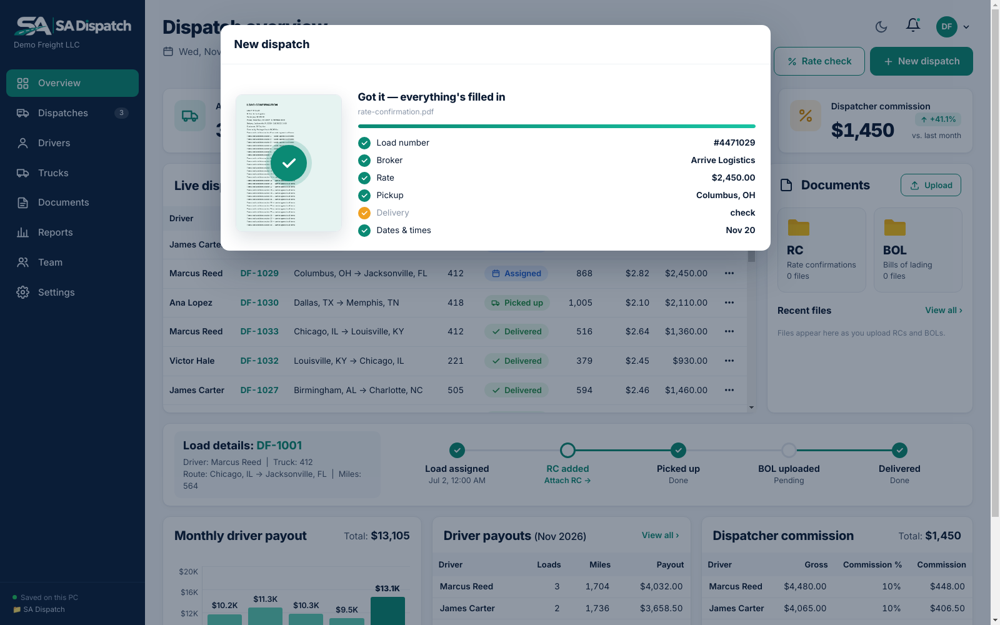
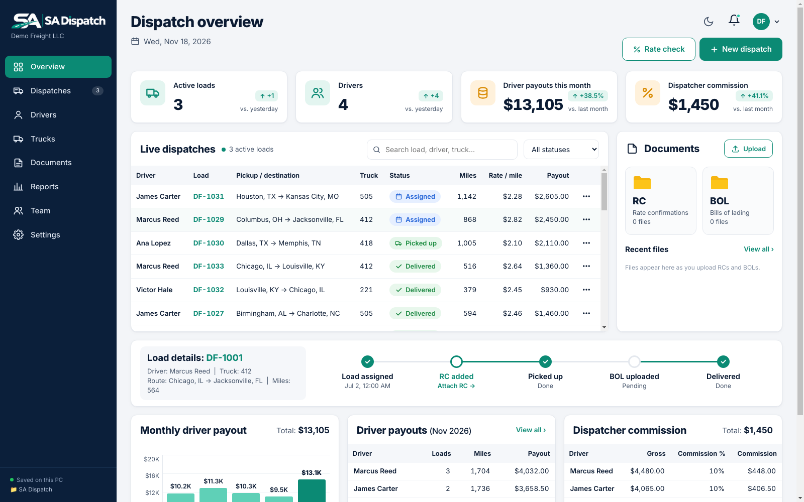
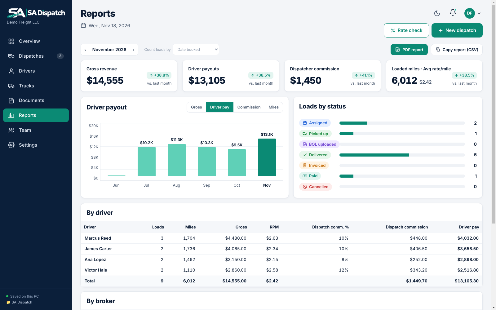
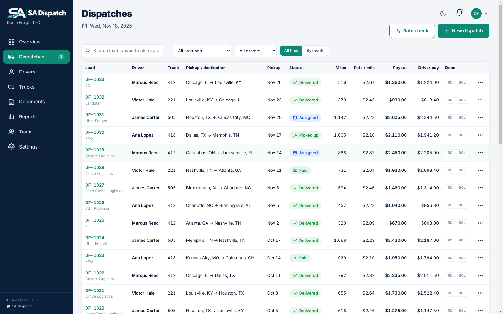
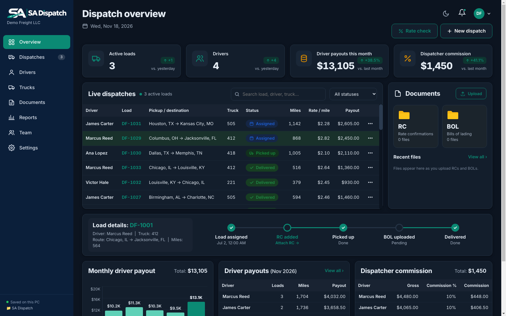
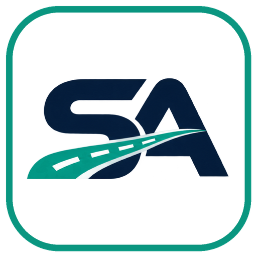

  

  
  
  
  

<h3 align="center">
  <a href="https://github.com/s7me3r/sa-dispatch/releases/latest">⬇️ Download for Windows</a> ·
  <a href="#-get-a-license">🔑 Get a license</a> ·
  <a href="#-faq">❓ FAQ</a>
</h3>

---

**SA Dispatch** is the desktop app for truck dispatchers and small carriers. Drop in a rate confirmation from any broker and the load is filled in for you: load number, broker, rate, pickup, delivery, dates and times. Then track every load from booked to paid, keep drivers and trucks organised, and see exactly what everyone earns.

  

## ✨ Features

<table>
<tr>
<td width="50%" valign="top">

### 📄 Reads any rate confirmation
Every broker's layout, including scanned PDFs. Load #, broker, rate, stops, dates and appointment times are pulled out in seconds. Anything that needs a second look is flagged in orange.

### 🚚 Live dispatch board
Every load from **Assigned → Picked up → Delivered → Invoiced → Paid**, with RC and BOL files attached to each load.

### 👤 Drivers & trucks
Phone numbers, trucks, commission % per driver, and a history of every load they ran.

</td>
<td width="50%" valign="top">

### 💵 Pay & commission, done for you
Driver pay, dispatch commission, rate per mile and loaded miles, calculated automatically for every load.

### 📊 Reports & PDF statements
Monthly and weekly reports by driver, broker and dispatcher. Export a clean PDF or copy to Excel in one click.

### 👥 Team & phone app
Add sub-dispatchers who see only their own loads and pay. Use SA Dispatch on your **iPhone or Android** too.

</td>
</tr>
</table>

## 📸 Screenshots

<b>Dispatch overview</b> 

<b>Reports</b> 

<b>All dispatches</b> 

<b>Night mode</b> 

## 🔒 Your data, safe

- **Your account:** sign in on any PC or phone and your loads are there.
- **A full copy on your PC:** loads, drivers, RCs and BOLs are always saved in your own folder too, with a backup every day.
- **Forgot your password?** Reset it by email in a few seconds.
- **Automatic updates:** new versions install themselves, and every update is digitally signed.

## 🚀 Getting started

1. **[Download the latest version](https://github.com/s7me3r/sa-dispatch/releases/latest)**: get `SA-Dispatch-Setup-x.x.x.exe` under *Assets*.
2. Run the installer. If Windows shows *“Windows protected your PC”*, click **More info → Run anyway**.
3. Open SA Dispatch, copy your **Machine ID**, and send it to us to get your license key.
4. Paste your key, create your account, and drop in your first rate confirmation.

**Sub-dispatchers** don't need a license: they install the app, click **“I work for a dispatch team”**, and sign in with the username and password you give them.

## 🔑 Get a license

Each license works on one PC. Monthly and lifetime plans are available.

📧 **Email: [s7me3r@gmail.com](mailto:s7me3r@gmail.com)** with your Machine ID (shown on the first screen of the app).

## ❓ FAQ

<b>Which computers does it run on?</b>

Windows 10 and 11, 64-bit. It's light, so no graphics card or powerful PC is needed.

<b>Does it work with my broker's rate confirmations?</b>

Yes. It reads any layout, including TQL, C.H. Robinson, Echo, Arrive, Coyote, RXO, Landstar and scanned PDFs. You always get a review screen before a load is saved.

<b>Can I use it on my phone?</b>

Yes. Go to <b>Team → Copy phone link</b>, open it on your iPhone (Safari) or Android (Chrome), sign in, and add it to your home screen.

<b>How do updates work?</b>

The app checks for new versions on its own and installs them with one click. You can also check under <b>Settings → Updates</b>.

<b>I moved to a new PC. What happens to my license?</b>

Email us your new Machine ID and we'll move your license. Your loads are in your account, so just sign in.

---

   
  <b>SA Dispatch</b> · Built for truck dispatchers 
  © 2026 SA Dispatch. All rights reserved. Licensed software. Copying or redistribution without a license is not permitted.

